# Xero Systems Monitor

A small, always-on-top monitor for the machines you own: your Windows PC and the Linux boxes you reach over SSH.

[](LICENSE)
[](https://github.com/T3rM1nAt0-R/xero-systems-monitor/releases)
[](#install)
[](https://tauri.app)

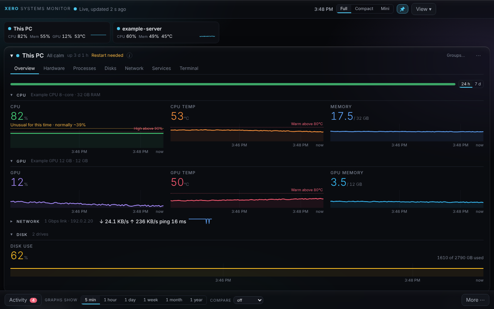

The screenshots show made-up demo data, not a real machine.

## Features

One window shows CPU, memory, disk, network, GPU and temperatures, plus GitHub Actions self-hosted runner jobs and Docker containers, with history you can scroll back through.

<table>
<tr>
<td width="50%">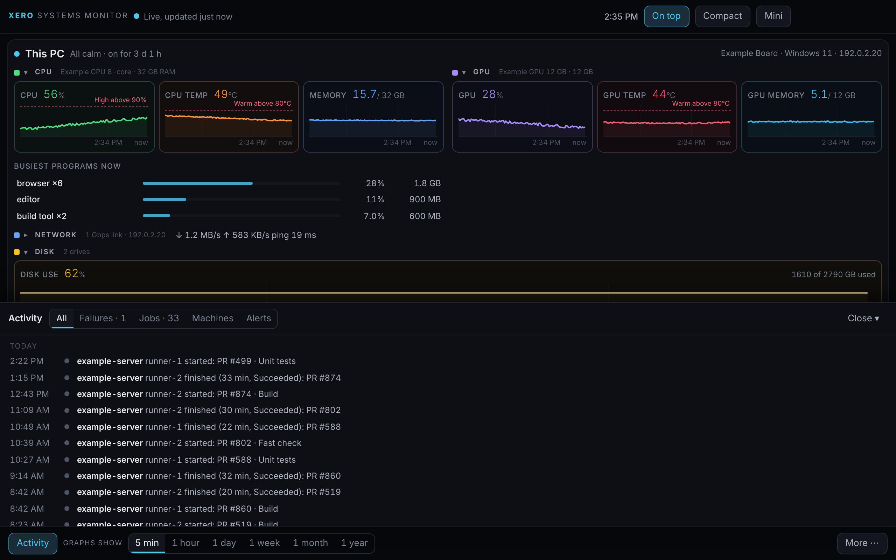</td>
<td width="50%">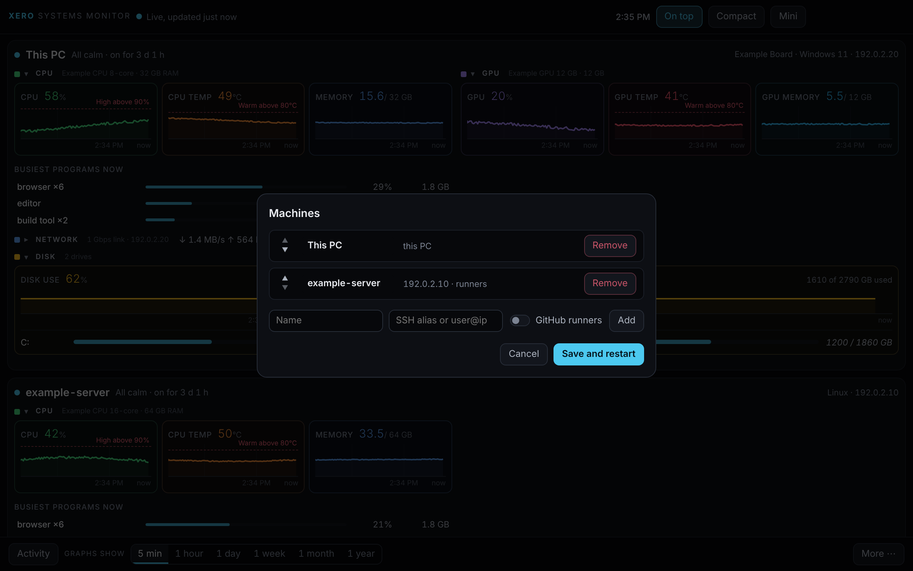</td>
</tr>
<tr>
<td valign="top">Activity drawer (press <b>E</b>): runner jobs, alerts and events, newest first.</td>
<td valign="top">Machines dialog: add Linux machines by SSH host name, nothing installed on them.</td>
</tr>
<tr>
<td width="50%">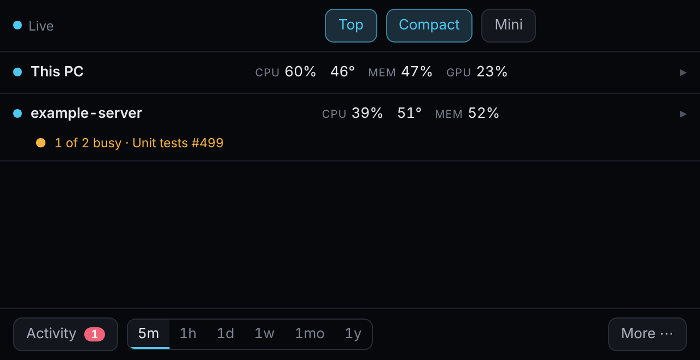</td>
<td width="50%">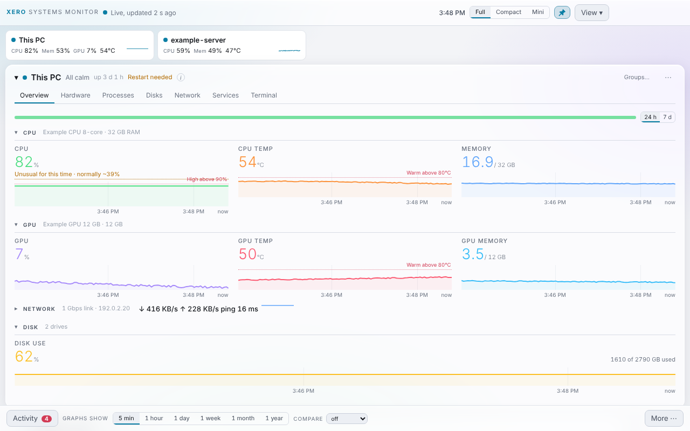</td>
</tr>
<tr>
<td valign="top">Compact view (press <b>C</b>): one line per machine. There is also a mini corner view (<b>M</b>). Click a machine name to fold its card into one bar; <b>F</b> folds all, <b>Shift+F</b> opens all. Press <b>Ctrl+K</b> to search for a machine, group or setting; drag cards to reorder them.</td>
<td valign="top">Light and dark themes, or follow Windows.</td>
</tr>
<tr>
<td width="50%">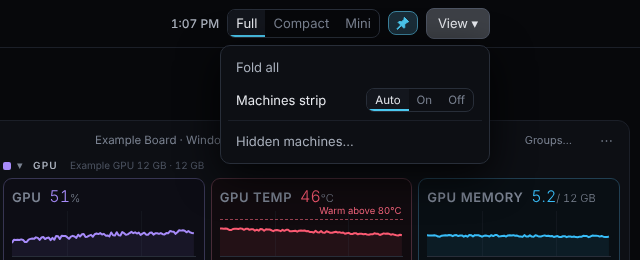</td>
<td width="50%">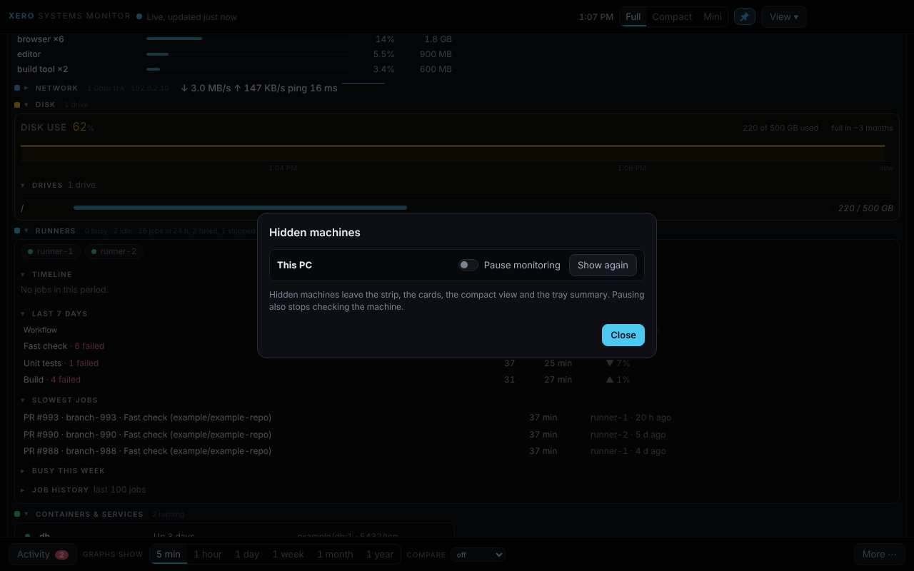</td>
</tr>
<tr>
<td valign="top">One view switch: <b>Full | Compact | Mini</b>, a pin for keep-on-top (<b>T</b>), and a <b>View</b> menu with Fold all, the machines strip (Auto, On or Off) and Hidden machines.</td>
<td valign="top">Hide machines you do not need (the <b>⋯</b> on a card or strip tile). They leave every view and the tray summary; Hidden machines lists them with Show again and Pause monitoring.</td>
</tr>
<tr>
<td width="50%">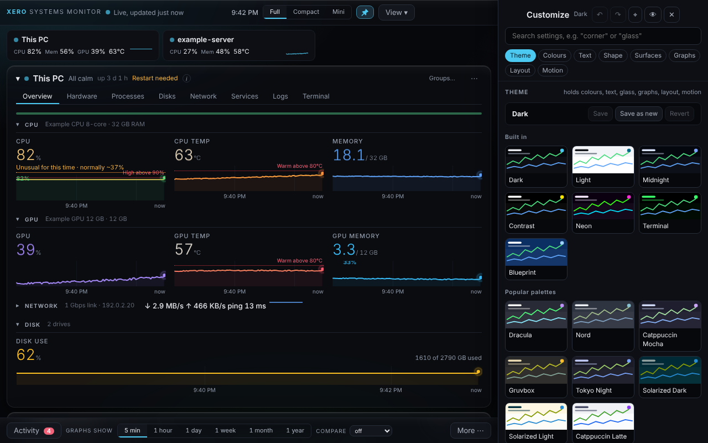</td>
<td width="50%">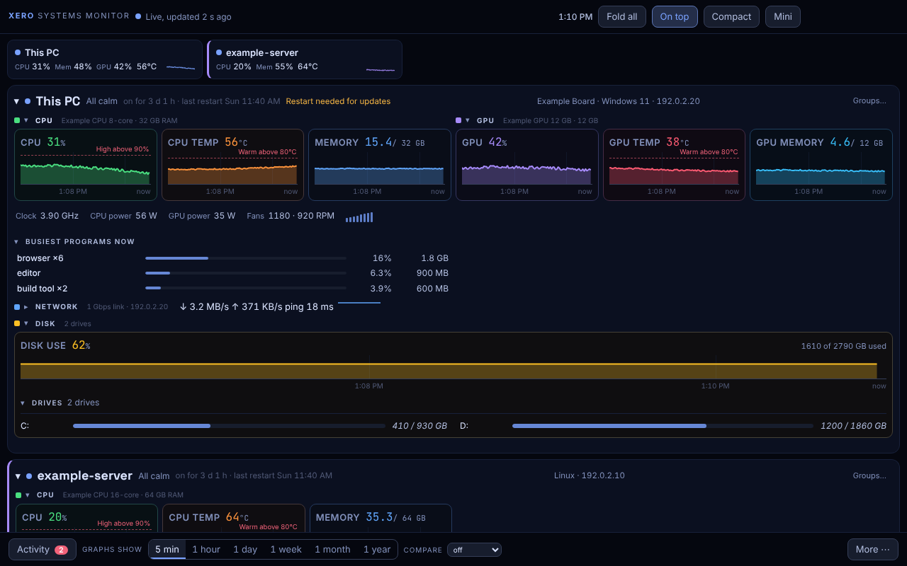</td>
</tr>
<tr>
<td valign="top">Customize (More &gt; Look &gt; Customize…, or <b>Ctrl+K</b>): a font, size and weight for each kind of text (12 bundled fonts), every colour, graph style, sizes, and themes, with a live preview.</td>
<td valign="top">The same window with the Midnight theme, other fonts, filled smooth graphs and a purple tint for one machine.</td>
</tr>
<tr>
<td width="50%">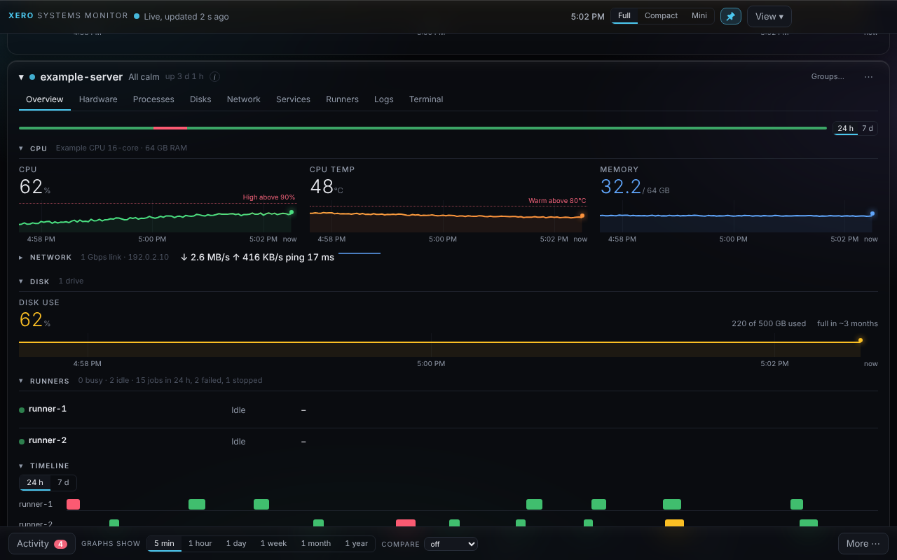</td>
<td width="50%">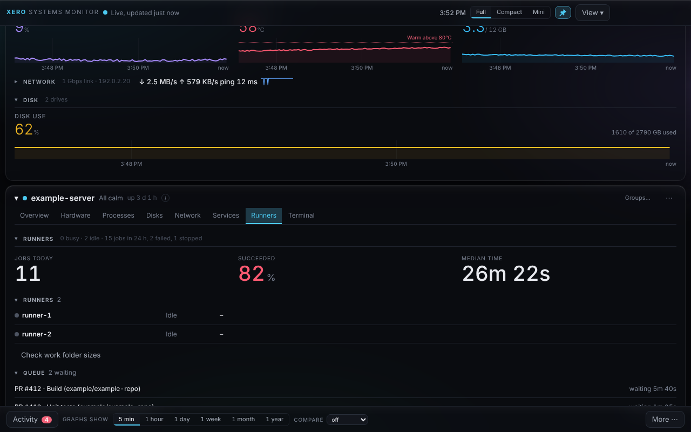</td>
</tr>
<tr>
<td valign="top">Tabs on every machine card: Overview, Hardware, Processes, Disks, Network, Services and Runners (only the ones that machine has). Overview keeps the main graphs, a short runners block and any failing containers. Use the arrow keys to move between tabs; each machine remembers its tab. Hover the <b>i</b> in the header for the board, system and address.</td>
<td valign="top">The Runners tab: runner chips, running jobs, timeline, last 7 days, slowest jobs, the busy heatmap and job history. Click the pin on any section header to pin that section to Overview.</td>
</tr>
<tr>
<td width="50%">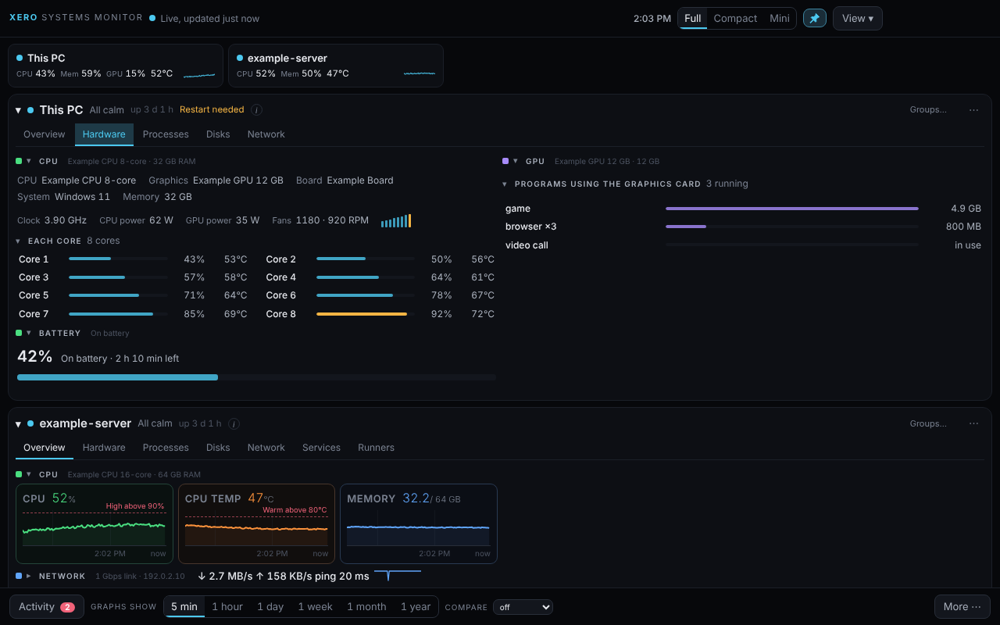</td>
<td valign="top">The Hardware tab: each CPU core with its load and temperature, fans, clock and power, the battery (charge, charging, time left) on laptops, and the programs using the graphics card (NVIDIA) with the memory each holds. Linux machines show the per-core numbers too.</td>
</tr>
</table>

- Customize: built-in themes (Dark, Light, Midnight, Solarized-like, High contrast, Neon); save, rename, delete, export and import your own; a colour per machine tints its card edge and tile; a warning when text and background are hard to read together
- This PC: CPU, memory, disk, network, ping, top programs, network connections by program (Windows), GPU (NVIDIA), CPU temperature
- This PC with LibreHardwareMonitor running: fan speeds, CPU clock, CPU and GPU power, per-core load
- Smooth folds, tab changes and menus, a thin loading bar and graph placeholders while data arrives (all off with the system "reduce motion" setting)
- Every machine card: uptime, last restart time and "Restart needed for updates" (Debian/Ubuntu and Windows)
- Remote Linux machines over your own SSH config, no agent to install on them
- Runner insights: a busy-hours heatmap for the week, a searchable job history, and a click on any job opens it on GitHub (its pull request, or the Actions page)
- GitHub Actions self-hosted runner jobs on this PC and on remote machines: running, finished, failed, and how long they took (found on this PC by themselves; for a remote machine turn on "GitHub runners" when you add it)
- Docker containers and failed systemd services on remote machines, with Restart, Stop, Start and Logs buttons (the ssh user needs the docker group)
- History from 5 minutes to 1 year, stored locally in SQLite
- "What was busy then?": click a point on a CPU or memory graph to see the busiest programs at that moment (kept once a minute for 3 days)
- Graph tools: drag across a graph to zoom (every graph of that machine follows, double-click to reset), compare with yesterday or last week (dashed copy), open one graph full-window to overlay other machines, save a graph as a picture or CSV
- Alerts when a limit is crossed, a disk is about to fill, or a job fails
- Your own limits per machine (CPU %, CPU and GPU temperature, disk % and "full in N days"), quiet hours (11 PM to 8 AM by default; pop-ups wait except "machine offline"), and a Mute button on each alert in the Activity drawer
- Tray icon with a status dot (green all calm, amber something needs a look, red a machine is offline or a job or container failed) and a hover text like "3 calm, 1 needs a look · CPU 23%"; autostart
- Updates itself from GitHub Releases (when you ask it to check)

Windows first. Linux and macOS later.

## Install

1. Open the [Releases page](../../releases) and download the latest installer: the `.exe` (NSIS) or the `.msi`.
2. Run it. Windows SmartScreen may say "Windows protected your PC / unknown publisher". The installers are not code signed yet (signing is planned, see [docs/releasing.md](docs/releasing.md)). Choose **More info**, then **Run anyway**.
3. Nothing else is needed: WebView2, which draws the window, is built into Windows 10 and 11.

The installed app checks GitHub for new versions and updates itself (More > Check for updates). Each update is signed, and the app refuses one that is not.

**Portable copy:** download `Xero.Systems.Monitor_<version>_x64_portable.zip`, unzip it anywhere (a USB stick works) and run `Xero Systems Monitor.exe`. The `portable.txt` file beside it keeps settings and history in a `data` folder next to the program. A portable copy does not update itself: download the new zip and copy your `data` folder across.

## Adding machines

Add a Linux machine in the app by the **SSH host name** from your `~/.ssh/config` (the app runs your system `ssh`, so users, ports, jump hosts and keys work as they do in your terminal).

- Log in with a key (or an agent). The app never asks for or stores a password, and a prompt would fail the connection.
- Nothing is installed on the server. The app sends a small shell probe over one long-lived SSH connection. The server only needs a POSIX `sh`.
- `nvidia-smi` and `docker` are optional: GPU and container cards appear only when the server has them. GPU use and memory on a server are the peak of a few quick samples per check, and the GPU graphs keep peaks on long ranges, so short bursts show.

Test it first: `ssh your-host true` must work without a prompt.

## CPU temperature

Windows does not give CPU temperature to normal programs. The app tries, in order:

1. The system sensors, when the machine exposes them.
2. [LibreHardwareMonitor](https://github.com/LibreHardwareMonitor/LibreHardwareMonitor), if you run it with its remote web server on (port 8085).
3. The Windows ACPI thermal zone (read through WMI by a hidden PowerShell call every few minutes). Many PCs report nothing useful here; the app then shows "not available".

## Privacy

Everything stays on your computer. The app talks only to the machines you add and, when you check for updates, to GitHub. No telemetry, no account.

## Development

The one check (also what CI runs on Windows and Linux):

```sh
cargo fmt --all --check
cargo clippy --workspace --all-targets -- -D warnings
cargo test --workspace          # includes the walls
cd app && npm ci && npm test && npm run lint
```

- Browser demo of the window with made-up data: `cd app && npm run dev`
- The desktop app: `cargo tauri dev` (needs `cargo install tauri-cli --version "^2" --locked`). Set `XSM_DEMO=1` to run on made-up data instead of live readings.
- Where things live: [docs/architecture.md](docs/architecture.md). Rules for code: [AGENTS.md](AGENTS.md). Releases: [docs/releasing.md](docs/releasing.md).

See [CONTRIBUTING.md](CONTRIBUTING.md). Security problems: see [SECURITY.md](SECURITY.md).

## Licence

MIT. See [LICENSE](LICENSE). Bundled third-party parts are listed in [THIRD-PARTY-NOTICES.md](THIRD-PARTY-NOTICES.md).
