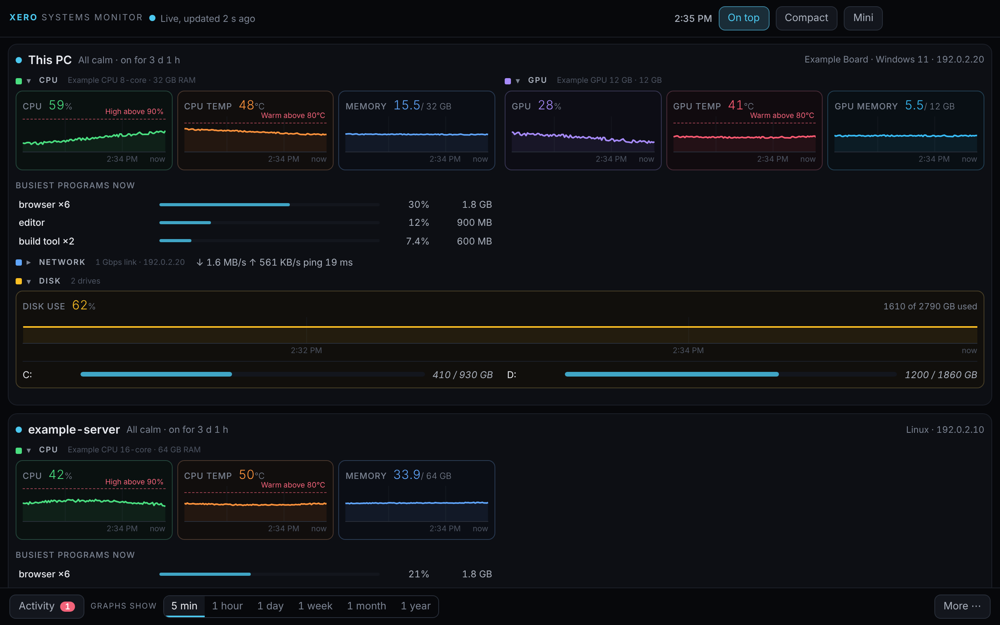
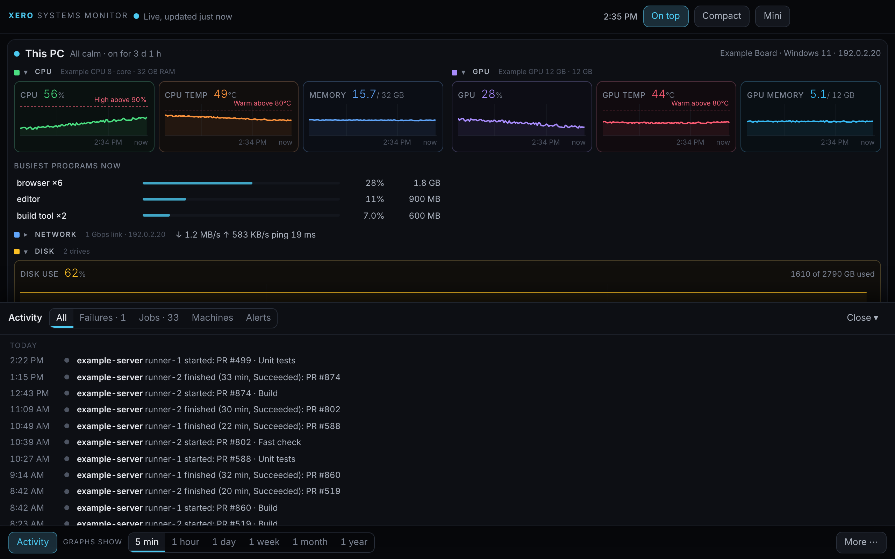
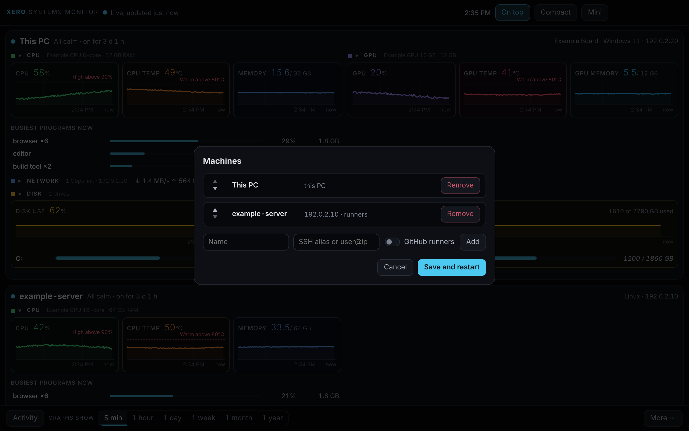
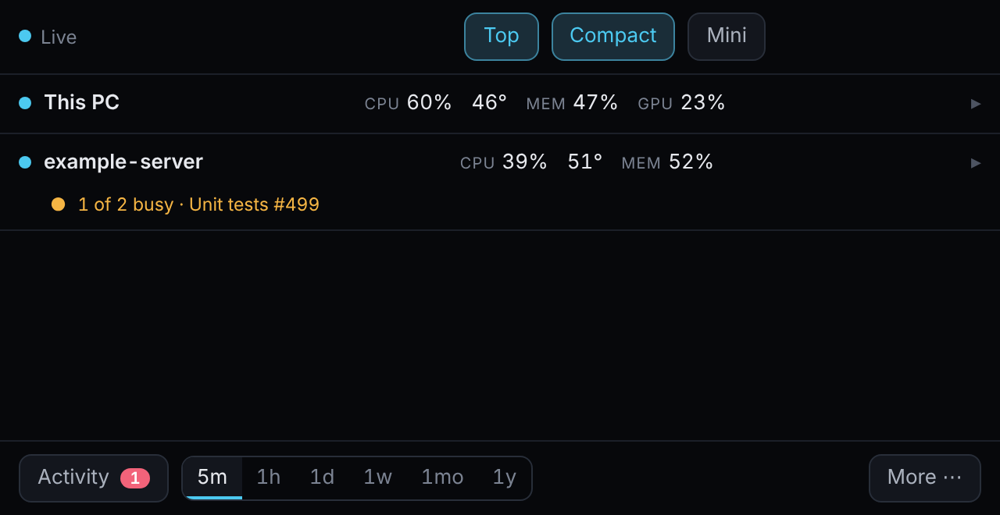
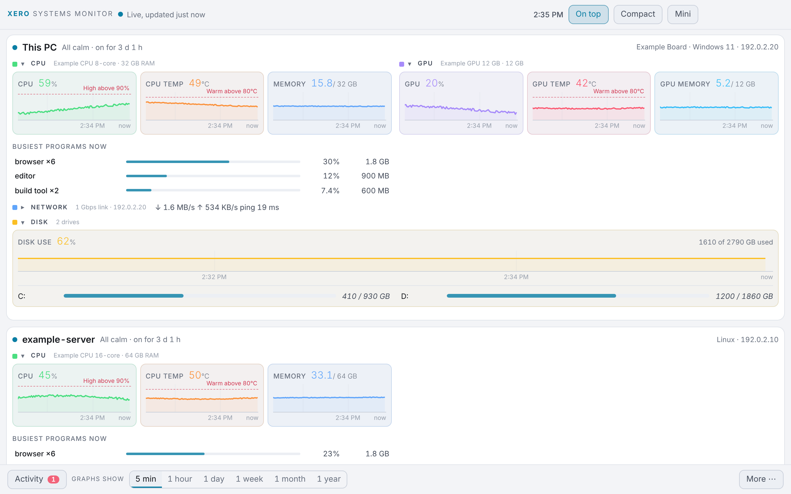

# Xero Systems Monitor

A small, always-on-top monitor for the machines you own: your Windows PC and the Linux boxes you reach over SSH.

[](LICENSE)
[](https://github.com/T3rM1nAt0-R/xero-systems-monitor/releases)
[](#install)
[](https://tauri.app)



The screenshots show made-up demo data, not a real machine.

## Features

One window shows CPU, memory, disk, network, GPU and temperatures, plus GitHub Actions self-hosted runner jobs and Docker containers, with history you can scroll back through.

<table>
<tr>
<td width="50%"></td>
<td width="50%"></td>
</tr>
<tr>
<td valign="top">Activity drawer (press <b>E</b>): runner jobs, alerts and events, newest first.</td>
<td valign="top">Machines dialog: add Linux machines by SSH host name, nothing installed on them.</td>
</tr>
<tr>
<td width="50%"></td>
<td width="50%"></td>
</tr>
<tr>
<td valign="top">Compact view (press <b>C</b>): one line per machine. There is also a mini corner view (<b>M</b>).</td>
<td valign="top">Light and dark themes, or follow Windows.</td>
</tr>
</table>

- This PC: CPU, memory, disk, network, ping, top programs, GPU (NVIDIA), CPU temperature
- Remote Linux machines over your own SSH config, no agent to install on them
- GitHub Actions self-hosted runner jobs: running, finished, failed, and how long they took
- Docker containers and failed systemd services on remote machines
- History from 5 minutes to 1 year, stored locally in SQLite
- Alerts when a limit is crossed, a disk is about to fill, or a job fails
- Tray icon, autostart
- Updates itself from GitHub Releases (when you ask it to check)

Windows first. Linux and macOS later.

## Install

1. Open the [Releases page](../../releases) and download the latest installer: the `.exe` (NSIS) or the `.msi`.
2. Run it. Windows SmartScreen may say "Windows protected your PC / unknown publisher". The installers are not code signed yet (signing is planned, see [docs/releasing.md](docs/releasing.md)). Choose **More info**, then **Run anyway**.
3. Nothing else is needed: WebView2, which draws the window, is built into Windows 10 and 11.

## Adding machines

Add a Linux machine in the app by the **SSH host name** from your `~/.ssh/config` (the app runs your system `ssh`, so users, ports, jump hosts and keys work as they do in your terminal).

- Log in with a key (or an agent). The app never asks for or stores a password, and a prompt would fail the connection.
- Nothing is installed on the server. The app sends a small shell probe over one long-lived SSH connection. The server only needs a POSIX `sh`.
- `nvidia-smi` and `docker` are optional: GPU and container cards appear only when the server has them.

Test it first: `ssh your-host true` must work without a prompt.

## CPU temperature

Windows does not give CPU temperature to normal programs. The app tries, in order:

1. The system sensors, when the machine exposes them.
2. [LibreHardwareMonitor](https://github.com/LibreHardwareMonitor/LibreHardwareMonitor), if you run it with its remote web server on (port 8085).
3. The Windows ACPI thermal zone (read through WMI by a hidden PowerShell call every few minutes). Many PCs report nothing useful here; the app then shows "not available".

## Privacy

Everything stays on your computer. The app talks only to the machines you add and, when you check for updates, to GitHub. No telemetry, no account.

## Development

The one check (also what CI runs on Windows and Linux):

```sh
cargo fmt --all --check
cargo clippy --workspace --all-targets -- -D warnings
cargo test --workspace          # includes the walls
cd app && npm ci && npm test && npm run lint
```

- Browser demo of the window with made-up data: `cd app && npm run dev`
- The desktop app: `cargo tauri dev` (needs `cargo install tauri-cli --version "^2" --locked`). Set `XSM_DEMO=1` to run on made-up data instead of live readings.
- Where things live: [docs/architecture.md](docs/architecture.md). Rules for code: [AGENTS.md](AGENTS.md). Releases: [docs/releasing.md](docs/releasing.md).

See [CONTRIBUTING.md](CONTRIBUTING.md). Security problems: see [SECURITY.md](SECURITY.md).

## Licence

MIT. See [LICENSE](LICENSE). Bundled third-party parts are listed in [THIRD-PARTY-NOTICES.md](THIRD-PARTY-NOTICES.md).
